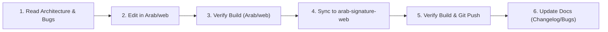

# Arab Signature Hotel & Suites — Master Implementation Plan for Developers & Coding Agents

> **PURPOSE**:
> This document defines the strict step-by-step execution protocol, coding standards, domain rules, and verification pipeline that every developer, worker, or AI coding agent **MUST** follow when building or modifying features in the Arab Signature Hotel & Suites ecosystem.

---

## 1. Mandatory Agent Execution Workflow (The 6-Step Pipeline)

Every task—whether a bug fix, UI tweak, or major feature—must execute in this exact order:

### Step 1: Pre-Flight Context Check
- Read `PROJECT_ARCHITECTURE.md` to confirm which portal, store method, and data model your task touches.
- Read `BUGS_AND_FIXES.md` to ensure you do not violate any anti-regression guardrails (e.g., missing `lucide-react` icon imports, `currentUser` naming, building boundaries).

### Step 2: Implement Changes in Active Dev Workspace
- Apply all code edits in `c:\Users\ADMIN\OneDrive\Desktop\Arab\web`.
- Preserve existing comments, docstrings, and luxury styling conventions.

### Step 3: Local Build & Static Verification
- Run `npm run build` inside `c:\Users\ADMIN\OneDrive\Desktop\Arab\web`.
- Confirm **0 compilation errors** and **0 unresolved imports**.

### Step 4: Mirror Changes to Production Git Workspace
- Copy every modified or newly created file from `c:\Users\ADMIN\OneDrive\Desktop\Arab\web` to `c:\Users\ADMIN\OneDrive\Desktop\arab-signature-web`.

### Step 5: Production Build & Git Push
- Run `npm run build` inside `c:\Users\ADMIN\OneDrive\Desktop\arab-signature-web`.
- Stage, commit with a conventional commit message (`feat:`, `fix:`, `style:`, `refactor:`), and push to `origin main`.

### Step 6: Documentation Update
- Append the new commit to `CHANGELOG.md`.
- If a bug was fixed, append a new `BUG-XXX` entry to `BUGS_AND_FIXES.md`.

---

## 2. Core Domain Implementation Specifications

### A. Room & Suite Reservation Engine (`BookingModal.jsx`, `ReceptionPortal.jsx`, `portalStore.js`)
1. **34-Room Physical Inventory**:
   - **Main Building (600 Wing — 20 Rooms: `601–620`)**:
     - Booking Code Format: `ARS-BGD-<4 digits><2 uppercase letters>` (e.g., `ARS-BGD-7812AB`).
     - Categories: Standard (`₦30,000`), Deluxe (`₦35,000`), Superior (`₦40,000`), Executive (`₦50,000`), Super Executive (`₦60,000`).
   - **Extension Building (100 Wing — 14 Rooms: `101–114`)**:
     - Booking Code Format: `ARS-EXT-<4 digits><2 uppercase letters>` (e.g., `ARS-EXT-9421XK`).
     - Categories: Superior (`₦40,000`), Executive (`₦50,000`), Super Executive (`₦60,000`), Diplomatic Suites (`₦120,000`).
2. **Mandatory Guest KYC Fields (Web & Counter)**:
   - `guestName` (Full Name)
   - `phone` (Phone Number)
   - `homeAddress` (Client Home Address)
   - `nextOfKinName`, `nextOfKinPhone`, `nextOfKinRelationship` (Next of Kin Details)
3. **Dual Counter Booking Modes (`ReceptionPortal.jsx`)**:
   - **Mode 1 — `Assign & Check In Now` (`bookingMode: 'Checked In'`)**:
     - Fields: `Check-In Date *`, `Duration (Nights)`, computed `Check-Out Date`, and optional `Proof of Payment` image/ref.
     - Action: Immediately marks room status as `'occupied'` and booking status as `'Checked In'`.
   - **Mode 2 — `Counter Reservation Hold` (`bookingMode: 'Reservation Hold'`)**:
     - Fields: `Reservation Date *` (date booked at counter), `Expected Check-In *` (date guest will return to occupy room), `Duration of Stay (Nights) *`, computed vacate date (`expectedCheckIn + nights`), and optional `Proof of Payment` image/ref.
     - Action: Immediately marks room status as `'reserved'` and booking status as `'Reservation Hold'`.

---

### B. Proof of Payment Compression & Server Sync (`imageCompressor.js`, `api/proof-of-payment.js`, `ProofOfPaymentModal.jsx`)
1. **Never Make Proof of Payment Compulsory**:
   - Both image upload and text reference fields must have `required={false}`.
2. **Client-Side Compression Pipeline**:
   - Every uploaded image must pass through `compressImage(file, { maxWidth: 1200, maxHeight: 1200, quality: 0.72 })` in `src/utils/imageCompressor.js`, reducing 3–10 MB camera photos to ~50–90 KB JPEGs.
3. **Server & Multi-Portal Visibility**:
   - Saved via `portalStore.uploadProofToServer()` to `/api/proof-of-payment` (backed by MantleDB) and stored on the booking as `proofOfPaymentImage`.
   - Must be viewable via `ProofOfPaymentModal.jsx` in:
     - **Reception Portal** (Bookings Ledger & Folio Receipt)
     - **Accountant Portal** (Suite Reservations Audit table with 1-click *Verify & Stamp Audit*)
     - **Admin Portal** (Master Payments & Backend Verifier table with 1-click *Confirm Payment Backend*)

---

### C. Official Receipt Generation & WhatsApp Dispatch (`ReceptionPortal.jsx`)
1. **Generate Receipt Trigger**:
   - Every booking row in the Reception Bookings Ledger must display a prominent **`Generate Receipt`** button.
   - Completing a Counter Walk-In or Counter Reservation Hold must automatically open the generated receipt modal (`setSelectedReceiptBooking(newBooking)`).
2. **Print & WhatsApp Actions**:
   - **`Print Receipt`**: Calls `window.print()` with clean print media rules (`print:hidden` on controls).
   - **`Send to WhatsApp`**: Calls `handleSendWhatsApp(booking)` which normalizes `booking.phone` to international format (`234...`), formats the complete folio receipt (Booking Code, Suite, Room #, Wing, Check-In/Out or Reservation Date/Expected Check-In, Nights, Amount, Payment Channel, and VIP Guest Portal Login URL), and opens `https://wa.me/<phone>?text=<encodedMessage>`.

---

### D. Food (`ARB-FDD`) & Drinks (`ARB-DRK`) Ordering & Dispatch System (`DiningPage.jsx`, `OrderTrackingPage.jsx`, `ReceptionPortal.jsx`, `AccountantPortal.jsx`)
1. **Order Code Generation**:
   - Food orders: `ARB-FDD-<6 alphanumeric chars>`
   - Drink orders: `ARB-DRK-<6 alphanumeric chars>`
   - Combined orders: Prefixed according to primary cart composition (`ARB-FDD-*` or `ARB-DRK-*`).
2. **Two Checkout Modes**:
   - **In-Lodge Room Bill**: Requires an active, checked-in room booking code (`ARS-BGD-*` or `ARS-EXT-*`). Appends the order amount directly to the guest's room folio bill.
   - **Outside / Walk-In / Pickup / Dining Hall**: Paid online via Paystack (no "Pay on Counter POS" option for food checkout).
3. **Main Reception Dispatch & Customer Tracking**:
   - All outside-room orders trigger a live notification at **Main Building Reception** and appear in the **Accountant Portal**.
   - Main Reception features an **Order Code Verification Terminal** where staff enter `ARB-FDD-*` / `ARB-DRK-*` to verify items and click **Confirm Pickup / Delivered**.
   - Customers track live status on `OrderTrackingPage.jsx`.

---

### E. Role-Based Access Control & Building Partitioning
| Role / Portal | Login Route | Permitted Scope & Capabilities | Restricted Actions |
| :--- | :--- | :--- | :--- |
| **Public Website & Guest** | `/` & `/#guest-portal` | Browse suites, dining/drinks, gallery, chat with Amira AI, book online, log into VIP Guest Portal with `ARS-*` code, track `ARB-*` orders. | Zero visibility into staff login URLs or admin controls. |
| **Main Receptionist** (`reception_main`) | Secret Reception Login | Full operational control over **Main Building (Rooms 601–620)**, outside food/drink pickup dispatch, intercom chat, receipt generation. | **Read-only** view of Extension Wing (`101–114`). Cannot reset all rooms or alter room rates. |
| **Extension Receptionist** (`reception_ext`) | Secret Reception Login | Full operational control over **Extension Wing (Rooms 101–114)**, intercom chat, receipt generation. | **Read-only** view of Main Building (`601–620`). Cannot reset all rooms or alter room rates. |
| **Chief Accountant** (`accountant`) | Secret Accountant Login | View all suite & dining revenues, inspect proof of payment slips, stamp financial audits, record operational expenses, export CSV/PDF audit reports. | Cannot check guests in/out or modify room rates. |
| **Executive Admin / GM** (`admin`) | Secret Admin Login | Full global control: room rates, dining/drink menu prices, staff credentials, backend payment verification, 30-day intercom audit, system logs. | Must follow safe confirmation prompts before destructive actions. |

---

## 3. UI/UX & Styling Standards
- **Color Palette**:
  - Primary Background: Deep Obsidian / Royal Burgundy (`#0a0104`, `#120208`, `#16030c`, `#5c0725`)
  - Primary Accent: Luminous Metallic Gold (`#d4af37`, `#f3e5ab`, `#aa820a`)
  - Status Badges: Emerald (`Available` / `Paid`), Rose (`Occupied` / `Checked In`), Sky (`Reservation Hold` / `Confirmed`), Amber (`Pending` / `Maintenance`).
- **Typography**:
  - Headings: `font-cinzel` (`Cinzel`, serif)
  - Body: `Plus Jakarta Sans`, sans-serif
  - Codes, Prices & Timestamps: `font-mono` (`Space Grotesk` / monospace)
