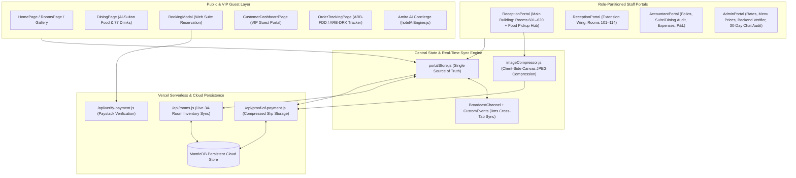

# Arab Signature Hotel & Suites — Master Project Architecture

> **ARCHITECTURAL NORTH STAR**:
> **Arab Signature Hotel & Suites (Nsugbe, Onitsha, Anambra State)** is a unified 5-star luxury hotel management, guest experience, and financial audit platform.
> Never drift from this core mission: **Seamless Arabian luxury for the guest, strict building-partitioned operational clarity for the front desk, and 100% auditable financial transparency for the Accountant and Executive Admin.**

---

## 1. High-Level System Architecture



---

## 2. Physical Hotel Topology (34 Authentic Rooms Across 2 Wings)

The physical property consists of **34 rooms** split strictly across two buildings:

### A. Main Building (600 Wing — 20 Rooms: `601` to `620`)
- **Booking Code Prefix**: `ARS-BGD-<4 digits><2 uppercase letters>` (e.g., `ARS-BGD-7812AB`)
- **Managed Exclusively By**: Main Building Receptionist (`reception_main`) & Admin
- **Special Responsibility**: Main Building Reception also serves as the **Central Pickup & Dispatch Hub** for all outside-room food (`ARB-FDD-*`) and drink (`ARB-DRK-*`) orders.
- **Room Breakdown**:
  - **Standard Room (`₦30,000`/night)**: Rooms `614, 616, 618` (3 rooms)
  - **Deluxe Room (`₦35,000`/night)**: Rooms `602, 604, 606, 608, 610, 620` (6 rooms)
  - **Superior Room (`₦40,000`/night)**: Rooms `603, 607, 611, 613, 617` (5 rooms)
  - **Executive Room (`₦50,000`/night)**: Rooms `601, 609, 619` (3 rooms)
  - **Super Executive Room (`₦60,000`/night)**: Rooms `605, 612, 615` (3 rooms)

### B. Extension Building (100 Wing — 14 Rooms: `101` to `114`)
- **Booking Code Prefix**: `ARS-EXT-<4 digits><2 uppercase letters>` (e.g., `ARS-EXT-9421XK`)
- **Managed Exclusively By**: Extension Wing Receptionist (`reception_ext`) & Admin
- **Room Breakdown**:
  - **Superior Room (`₦40,000`/night)**: Rooms `101, 105, 106, 108, 111` (5 rooms)
  - **Executive Room (`₦50,000`/night)**: Rooms `103, 104, 112` (3 rooms)
  - **Super Executive Room (`₦60,000`/night)**: Rooms `102, 109, 113` (3 rooms)
  - **Diplomatic Suite (`₦120,000`/night)**: Rooms `107, 110, 114` (3 suites)

---

## 3. Repository & Directory Structure

```text
Arab/web/ ( mirrored to arab-signature-web/ )
├── api/
│   ├── rooms.js                    # Vercel Serverless 34-room inventory sync (MantleDB)
│   ├── proof-of-payment.js         # Vercel Serverless compressed proof slip storage
│   └── verify-payment.js           # Vercel Serverless Paystack transaction verifier
├── public/
│   ├── dining/                     # High-res Al-Sultan food plating & 77 bottle packshots
│   ├── gallery/                    # 4K HDR hotel exterior, suites, pool & lounge photography
│   └── logo.jpg                    # Official Arab Signature Hotel monogram
├── src/
│   ├── components/
│   │   ├── AiConcierge.jsx         # Floating "Amira" AI Concierge + Direct WhatsApp CTA
│   │   ├── BookingModal.jsx        # Multi-step online suite reservation + Paystack modal
│   │   ├── Footer.jsx              # Luxury footer (zero staff links exposed)
│   │   ├── GuestSessionPassModal.jsx # Printable/shareable VIP digital suite keycard pass
│   │   ├── LightboxModal.jsx       # 4K photo gallery fullscreen viewer
│   │   ├── LuxuryPromoPopup.jsx    # Non-intrusive cadence-controlled promo popups
│   │   ├── Navbar.jsx              # Responsive public navigation + Guest Portal trigger
│   │   └── ProofOfPaymentModal.jsx # Fullscreen slip inspector for Admin, Accountant & Reception
│   ├── data/
│   │   ├── aiKnowledgeBase.js      # Knowledge base & FAQ rules for Amira AI
│   │   ├── hotelData.js            # Static marketing copy, amenities, and gallery metadata
│   │   └── portalStore.js          # Single source of truth for rooms, bookings, dining, chat, auth
│   ├── pages/
│   │   ├── HomePage.jsx            # Cinematic hero, suites showcase, leisure & dining preview
│   │   ├── RoomsPage.jsx           # 2-level wing/category filterable suites catalog
│   │   ├── DiningPage.jsx          # Al-Sultan Fine Dining (25 dishes) & VIP Bar (77 drinks)
│   │   ├── FacilitiesPage.jsx      # Olympic pool, VIP lounge, Silent Disco, 24/7 power
│   │   ├── LocationPage.jsx        # 100% free Google Maps embed & turn-by-turn directions
│   │   ├── AboutPage.jsx           # Executive hospitality manifesto & Arabian heritage
│   │   ├── ContactPage.jsx         # Direct concierge contact & inquiry form
│   │   ├── CustomerDashboardPage.jsx # VIP Guest Portal (booking code login, cultural welcome, folio)
│   │   ├── OrderTrackingPage.jsx   # Live ARB-FDD / ARB-DRK food & drink order status page
│   │   ├── ReceptionLoginPage.jsx  # Dual-wing receptionist authentication
│   │   ├── ReceptionPortal.jsx     # Front-desk room matrix, counter walk-in/hold, receipt & WhatsApp
│   │   ├── AccountantLoginPage.jsx # Finance controller authentication
│   │   ├── AccountantPortal.jsx    # Financial audit ledger, proof slip inspector, expenses, P&L
│   │   ├── AdminLoginPage.jsx      # Executive GM authentication
│   │   └── AdminPortal.jsx         # Master rate/menu control, backend payment verifier, chat audit
│   ├── utils/
│   │   ├── hotelAiEngine.js        # Real-time natural language engine for Amira AI
│   │   ├── imageCompressor.js      # Client-side HTML5 Canvas JPEG compressor
│   │   └── paystack.js             # Paystack inline checkout & mode switcher
│   ├── App.jsx                     # Hash/state router & global layout orchestrator
│   └── main.jsx                    # React 19 entry point
├── BUGS_AND_FIXES.md               # Anti-regression bug registry
├── CHANGELOG.md                    # Complete commit-by-commit history
├── IMPLEMENTATION_PLAN.md          # SOP for workers and coding agents
├── PROJECT_ARCHITECTURE.md         # Master system architecture (this file)
├── ROADMAP.md                      # Strategic product roadmap
└── vercel.json                     # Vercel SPA & Serverless API routing rules
```

---

## 4. Core Data Schemas (`portalStore.js`)

### 1. `Booking` Object
```javascript
{
  id: "ARS-BGD-7812AB",             // ARS-BGD-* (Main) or ARS-EXT-* (Extension)
  building: "Main Building",        // "Main Building" | "Extension Building"
  guestName: "Chief Anthony Eze",
  phone: "08031234567",
  email: "guest@example.com",
  homeAddress: "14 Ridge Road, GRA, Onitsha",
  nextOfKinName: "Mrs.Ada Eze",
  nextOfKinPhone: "08037654321",
  nextOfKinRelationship: "Spouse",
  bookingMode: "Checked In",        // "Checked In" | "Reservation Hold"
  reservationDate: "2026-10-26",    // Date reservation hold was created at counter
  expectedCheckIn: "2026-10-28",    // Date guest will arrive (for Reservation Hold)
  checkIn: "2026-10-28",
  checkOut: "2026-10-30",
  nights: 2,
  roomType: "executive",
  roomName: "Executive Room",
  roomNumber: "601",
  amount: 100000,
  paymentMethod: "POS Terminal (Front Desk)",
  paymentStatus: "Paid",
  proofOfPayment: "POS RRN #849201", // Optional text reference
  proofOfPaymentImage: "data:image/jpeg;base64,...", // Optional compressed JPEG slip
  status: "Checked In",             // "Checked In" | "Reservation Hold" | "Confirmed" | "Checked Out"
  accountantAudited: false,
  source: "Front Desk Counter (Checked In)",
  createdAt: "10/26/2026, 3:00:00 PM"
}
```

### 2. `DiningOrder` Object
```javascript
{
  id: "ARB-FDD-8492XK",             // ARB-FDD-* (Food) or ARB-DRK-* (Drinks)
  orderType: "food",                // "food" | "drinks"
  guestName: "Chief Anthony Eze",
  phone: "08031234567",
  isLodgeGuest: true,               // true = attached to room folio; false = outside/pickup order
  isOutsideRoom: false,
  bookingId: "ARS-BGD-7812AB",      // Linked room booking code if in-lodge
  roomNumber: "601",
  serviceLocation: "In-Room Suite Delivery (Room #601)",
  items: [{ id: "f1", name: "Jollof Rice & Grilled Turkey", qty: 2, price: 8500 }],
  amount: 17000,
  paymentMethod: "Room Bill Folio (Settle at Checkout)", // or "Paystack (Online Verified)"
  paymentStatus: "Charged to Room Bill",                 // or "Paid"
  orderStatus: "Preparing",         // "Preparing" | "Ready for Pickup" | "Delivered / Picked Up"
  accountantAudited: false,
  createdAt: "10/26/2026, 3:15:00 PM"
}
```

---

## 5. Non-Negotiable Architectural Guardrails

1. **Zero Public Staff Links**: Staff portals (`Admin`, `Reception`, `Accountant`) must never be linked in the public `Navbar.jsx` or `Footer.jsx`. They are accessed exclusively via secret hash routes / URLs.
2. **Strict Wing Partitioning**: Main Building Receptionist (`601–620`) and Extension Wing Receptionist (`101–114`) can view the entire 34-room hotel status for coordination, but can only mutate rooms and bookings belonging to their assigned wing.
3. **Immutable Historical Records**: Past AI chat messages and checked-out guest folios are historical records. Once a guest checks out, their booking code displays the Checked-Out summary and cannot be reused for a new active stay; returning guests receive a brand-new code while their lifetime profile links all past stays.
4. **Zero-Cost External Dependencies**: Google Maps must remain on the 100% free iframe embed (`LocationPage.jsx`), and image compression must run client-side (`imageCompressor.js`) so serverless payloads remain tiny and fast.
