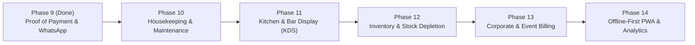

# Arab Signature Hotel & Suites — Strategic Product Roadmap

> **Purpose**: This document tracks the completed milestones (Phases 1–9) and defines the upcoming strategic evolution (Phases 10–14) of the **Arab Signature Hotel & Suites** digital hospitality ecosystem in Kano, Nigeria.

---

## Completed Milestones (Phases 1–9)

### Phase 1: Luxury Brand Identity & Digital Showcase (`Complete`)
- [x] **Royal Obsidian & Imperial Gold Design System**: Dark-mode luxury palette (`#0A0D14` base, `#D4AF37` gold accents, `Playfair Display` + `Plus Jakarta Sans` typography).
- [x] **Curated 4K Visual Architecture**: Authentic 4K photography across 5 gallery categories (Suites & Rooms, Exterior & Facade, Lounge & Reception, Hallways & Ambiance, Amenities & Baths) with interactive category filtering and fullscreen lightbox inspection.
- [x] **SEO & OpenGraph Optimization**: Full structured metadata, Kano hospitality keywords, and mobile-first responsive layout.

### Phase 2: Dual-Wing 34-Room Inventory Engine (`Complete`)
- [x] **Main Building (600 Wing — 20 Rooms)**:
  - **Standard Deluxe (`₦50,000/night`)**: Rooms `601`, `602`, `604`, `606`, `607`, `613`, `614`, `615`, `616`, `618`, `619`, `620`, `621`, `622`, `623`.
  - **Executive Suite (`₦60,000/night`)**: Rooms `603`, `608`, `609`, `612`, `617`.
- [x] **Extension Building (100 Wing — 14 Rooms)**:
  - **Studio Room (`₦35,000/night`)**: Rooms `101` – `114`.
- [x] **Interactive Room Inspection & Booking**: Room-level status badges, instant date calculations, and mandatory guest KYC capture (**Home Address** and **Next of Kin**).

### Phase 3: Al-Sultan Fine Dining & Beverage Lounge (`Complete`)
- [x] **25-Dish Culinary Menu**: Northern Nigerian royal delicacies, Arabian grilles, continental classics, and soups with custom bespoke food photography.
- [x] **77-Item Beverage Catalog**: Soft drinks, malt & milk drinks, exotic juices, energy drinks, non-alcoholic wines, and herbal bitters with authentic studio bottle imagery.
- [x] **Dual Fulfillment Modes**:
  - **Lodge Room Bill Consolidation**: Checked-in guests add food/drinks directly to their active room tab using their `ARB-XXXX` booking code.
  - **Standalone Pickup & Dine-In**: Walk-in or web customers place direct food (`ARB-FDD-XXXX`) and drink (`ARB-DRK-XXXX`) orders via bank transfer or Paystack.

### Phase 4: Amira AI Concierge & Voice Assistant (`Complete`)
- [x] **Multi-Language Hospitality AI**: Real-time chat and voice synthesis in **English, Hausa, and Arabic**.
- [x] **Deep Catalog Grounding**: Context-aware answers for room rates, check-in policies, Al-Sultan menu pricing, and Kano travel guidance.

### Phase 5: Multi-Channel Payment & Settlement (`Complete`)
- [x] **Paystack Online Gateway**: Instant card, bank transfer, and USSD checkout for web bookings and standalone orders.
- [x] **Direct Bank Transfer Workflow**: Clear account details and reference generation (`ARB-XXXX`, `ARB-FDD-XXXX`, `ARB-DRK-XXXX`).
- [x] **Walk-In Counter Settlement**: Cash, POS Terminal, and Transfer recording at the front desk.

### Phase 6: Role-Based Staff Portals & Real-Time Intercom (`Complete`)
- [x] **Main Reception Portal (`/portal/reception-main`)**: Full control over the 600 Wing (20 rooms) + Al-Sultan Food & Drinks Pickup Hub.
- [x] **Extension Reception Portal (`/portal/reception-ext`)**: Dedicated control over the 100 Wing (14 studio rooms).
- [x] **Accountant Portal (`/portal/accountant`)**: Read-only financial ledger, revenue breakdowns by wing and payment channel, CSV export, and payment proof inspection.
- [x] **Super Admin Portal (`/portal/admin`)**: Full 34-room control, staff account provisioning, audit trail review, and system health diagnostics.
- [x] **Inter-Wing Staff Intercom**: Real-time messaging and audio notification alerts between Main Reception, Extension Reception, Accountant, and Admin.

### Phase 7: VIP Guest Self-Service & Order Tracking (`Complete`)
- [x] **VIP Guest Portal (`/my-booking`)**: Self-service lookup by Booking Code (`ARB-XXXX`) to inspect stay duration, room number, itemized folio bill, and instant printable receipt.
- [x] **Dedicated Food & Drink Order Tracker (`/track-order`)**: Real-time status progression (`Pending Confirmation` → `Preparing` → `Ready for Pickup` → `Delivered / Picked Up`) when a customer enters their `ARB-FDD-XXXX` or `ARB-DRK-XXXX` code.

### Phase 8: Counter Reservation Holds & Reception Order Verification (`Complete`)
- [x] **Two-Mode Counter Booking**:
  - **Assign & Check In Now**: Immediate room occupancy with Check-In and Expected Check-Out dates.
  - **Counter Reservation Hold**: Pre-arrival reservation workflow capturing **Reservation Date**, **Expected Check-In**, and **Duration of Stay (Nights)** without premature check-out fields.
- [x] **Main Reception Order Code Verification Bar**: Instant search and 1-click confirmation/pickup completion for `ARB-FDD-XXXX` and `ARB-DRK-XXXX` codes.
- [x] **Safety Guardrails**: Removal of bulk reset ("Make Main/Ext Available") buttons from Reception portals to prevent accidental state wipes.

### Phase 9: Server-Synced Compressed Proof of Payment & WhatsApp Receipt Dispatch (`Complete`)
- [x] **Client-Side Image Compression (`imageCompressor.js`)**: Automatically resizes and compresses 3–10 MB camera/gallery transfer slips down to ~50–90 KB JPEG payloads.
- [x] **Vercel Serverless Sync (`/api/proof-of-payment`)**: Persists compressed payment proofs to MantleDB so Admin and Accountant portals can inspect slips from any device via the `ProofOfPaymentModal` lightbox.
- [x] **1-Click Receipt & WhatsApp Dispatch**: Receptionists can click **Generate Receipt** to print a thermal/A4 receipt and **Send to WhatsApp** to immediately message the itemized receipt to the guest's registered phone number (with automatic Nigerian `+234` normalization).

---

## Upcoming Strategic Phases (Phases 10–14)

### Phase 10: Housekeeping & Maintenance Dispatch System (`Next Up`)
- **Automated Cleaning Queue**: When a room transitions from `Occupied` to `Cleaning` at check-out, automatically generate a prioritized housekeeping ticket assigned to the wing's floor staff.
- **Maintenance Work Orders**: Allow Receptionists to log specific fault categories (AC servicing, plumbing, smart TV, keycard lock) when setting a room to `Maintenance`, tracking resolution time and technician sign-off.
- **Housekeeping Mobile View**: Simplified mobile checklist for room attendants to mark rooms `Clean & Inspected`.

### Phase 11: Dedicated Kitchen & Bar Display System (KDS)
- **Live Kitchen Screen**: Dedicated tablet view for the Al-Sultan kitchen and bar staff that chimes when a new `ARB-FDD-XXXX` or `ARB-DRK-XXXX` order is confirmed.
- **Prep Timer & Item Toggling**: Allow chefs to mark individual dishes as `Cooking` or `Plated`, automatically notifying the Main Receptionist when the tray is ready for guest pickup or room delivery.

### Phase 12: Beverage & Kitchen Stock Depletion Alerts
- **Real-Time Bottle & Portion Tracking**: Link the 77-drink catalog and 25-dish menu to live stock counts in MantleDB.
- **Low-Stock Warnings**: Alert the Accountant and Admin when high-velocity items (e.g., Hollandia Yoghurt, Exotic Juices, Suya platters) drop below reorder thresholds, and automatically grey out `Sold Out` items on the public menu.

### Phase 13: Corporate Accounts, Group Bookings & Event Hall Reservations
- **Multi-Room Group Folio**: Enable Reception and Admin to book multiple rooms under a single corporate or wedding delegation master code (`ARB-GRP-XXXX`).
- **Consolidated Corporate Invoicing**: Generate PDF tax invoices and monthly statements in the Accountant Portal for partner organizations, airlines, and NGOs visiting Kano.

### Phase 14: Offline-First Progressive Web App (PWA) & Executive BI
- **Service Worker Offline Queue**: Allow Main and Extension Receptionists to continue checking in guests and printing receipts during brief internet outages, automatically syncing queued mutations to `/api/portal-state` and `/api/proof-of-payment` once connectivity resumes.
- **Executive Occupancy & RevPAR Analytics**: Monthly occupancy heatmaps, Average Daily Rate (ADR), and Revenue Per Available Room (RevPAR) trend charts inside the Super Admin and Accountant portals.
